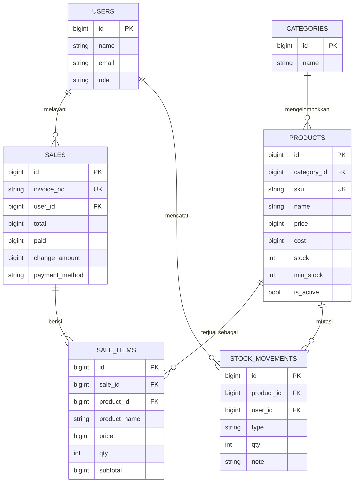

# Dokumentasi SDLC — TokoKu POS

Model proses: **Waterfall iteratif ringan** (analisis → desain → implementasi → pengujian → deployment), cocok untuk proyek akademik/tim kecil dengan kebutuhan yang relatif stabil.

---

## 1. Analisis Kebutuhan

### 1.1 Latar belakang & tujuan
Toko kecil masih sering mencatat penjualan dan stok secara manual sehingga rawan salah hitung, stok kosong tak terdeteksi, dan rekap penjualan lambat. Tujuan: aplikasi web yang mempercepat transaksi kasir, menjaga akurasi stok otomatis, dan menyediakan laporan penjualan.

### 1.2 Pemangku kepentingan
| Aktor | Kebutuhan utama |
|---|---|
| Admin (pemilik) | Kelola produk, kategori, stok; lihat laporan; seluruh transaksi |
| Kasir | Melayani transaksi cepat, cetak struk, lihat transaksinya sendiri |

### 1.3 Kebutuhan fungsional
| ID | Kebutuhan | Prioritas |
|---|---|---|
| F-01 | Login/logout dengan peran admin & kasir | Tinggi |
| F-02 | CRUD produk (SKU unik, harga, modal, stok minimum, status aktif) | Tinggi |
| F-03 | CRUD kategori | Sedang |
| F-04 | Transaksi kasir: cari produk, keranjang, hitung total & kembalian | Tinggi |
| F-05 | Stok berkurang otomatis saat transaksi; transaksi ditolak jika stok kurang | Tinggi |
| F-06 | Stok masuk & penyesuaian stok dengan riwayat mutasi | Tinggi |
| F-07 | Metode bayar tunai / transfer / QRIS | Sedang |
| F-08 | Struk transaksi & riwayat transaksi | Sedang |
| F-09 | Dashboard: penjualan hari ini, stok menipis | Sedang |
| F-10 | Laporan per rentang tanggal: pendapatan, per hari, produk terlaris | Sedang |

### 1.4 Kebutuhan non-fungsional
- **Keamanan:** password di-hash, CSRF, otorisasi per peran di server, pendaftaran publik dinonaktifkan.
- **Integritas data:** transaksi atomik (DB transaction), baris produk dikunci saat checkout, harga & nama disalin ke `sale_items`.
- **Kinerja:** halaman kasir memuat produk sekali dan memfilter di sisi klien; target checkout < 1 detik untuk 20 item.
- **Usability:** responsif (Tailwind), dapat dipakai di tablet.
- **Maintainability:** logika bisnis di service class, ada automated test dan CI.

### 1.5 Batasan & asumsi
Satu toko / satu cabang; mata uang Rupiah tanpa desimal; tanpa integrasi pembayaran nyata (QRIS/transfer hanya dicatat); tanpa barcode scanner (pencarian manual — scanner USB berfungsi sebagai keyboard sehingga bisa dipakai di kolom cari).

---

## 2. Perancangan

### 2.1 Arsitektur
Monolit **MVC Laravel**: Route → Middleware (auth, role) → Controller → Service/Model → Blade view. Kasir memakai Alpine.js untuk keranjang dan mengirim JSON ke `POST /pos/checkout`.

### 2.2 Use case
- Admin: semua fitur kasir + kelola produk/kategori/stok + laporan.
- Kasir: login, transaksi, cetak struk, lihat riwayat transaksinya.

### 2.3 ERD


### 2.4 Alur checkout
```mermaid
sequenceDiagram
    participant K as Kasir (browser)
    participant C as PosController
    participant S as CheckoutService
    participant D as Database
    K->>C: POST /pos/checkout (items, paid, method)
    C->>C: validasi input
    C->>S: process()
    S->>D: BEGIN + SELECT ... FOR UPDATE (produk)
    S->>S: cek stok & pembayaran
    S->>D: INSERT sales, sale_items, stock_movements; UPDATE stock
    S->>D: COMMIT
    S-->>K: 200 {redirect: struk} / 422 {errors}
```

### 2.5 Keputusan desain penting
| Keputusan | Alasan |
|---|---|
| Harga disimpan sebagai integer Rupiah | Menghindari galat floating point |
| `sale_items` menyimpan snapshot nama & harga | Riwayat tidak berubah saat produk diedit |
| Produk memakai soft delete | Struk lama tetap bisa menampilkan produk yang sudah dihapus |
| Stok tidak diedit lewat form produk | Semua perubahan stok punya jejak di `stock_movements` |
| Kasir hanya melihat transaksi sendiri | Pemisahan hak akses |

---

## 3. Implementasi
Lihat `README.md` untuk struktur kode. Ringkasan modul:

1. **Auth & peran** — Laravel Breeze; kolom `users.role`; `RoleMiddleware` dipasang pada grup route admin.
2. **Master data** — `ProductController`, `CategoryController` dengan validasi Form di controller.
3. **Kasir** — `PosController` + `CheckoutService` (transaksi atomik, `lockForUpdate`, penggabungan baris produk duplikat).
4. **Stok** — `StockController`: restock dan penyesuaian, menolak stok negatif.
5. **Pelaporan** — `ReportController` memakai agregasi SQL (`sum`, `group by`).

Konvensi: PSR-12, nama tabel jamak, pesan kesalahan berbahasa Indonesia.

---

## 4. Pengujian

### 4.1 Strategi
| Level | Alat | Cakupan |
|---|---|---|
| Feature/integrasi | PHPUnit + `RefreshDatabase` (SQLite in-memory) | Checkout, otorisasi peran |
| Manual / UAT | Checklist di bawah | Alur pengguna end-to-end |
| CI | GitHub Actions | `php artisan test` pada setiap push |

### 4.2 Test otomatis
| ID | Skenario | Hasil yang diharapkan |
|---|---|---|
| T-01 | Checkout valid | Sale + item + mutasi tercatat, stok berkurang, kembalian benar |
| T-02 | Stok tidak cukup | 422, tidak ada sale, stok tetap |
| T-03 | Uang tunai kurang | 422, stok tetap |
| T-04 | Dua baris produk sama melebihi stok | 422 (baris digabung) |
| T-05 | Tamu membuka `/pos` | Redirect ke login |
| T-06 | Kasir membuka halaman admin | 403 |
| T-07 | Kasir buka kasir, admin buka produk | 200 |
| T-08 | Kasir membuka struk kasir lain | 403; pemilik 200 |

### 4.3 Checklist UAT (manual)
- [ ] Login admin & kasir; menu yang tampil sesuai peran
- [ ] Tambah produk → muncul di halaman kasir
- [ ] Transaksi tunai: kembalian benar, struk tercetak, stok berkurang
- [ ] Transaksi QRIS/transfer: bayar pas
- [ ] Produk stok ≤ minimum muncul di dashboard
- [ ] Restock menambah stok dan muncul di riwayat mutasi
- [ ] Laporan: total sama dengan jumlah struk pada rentang tanggal

### 4.4 Hasil pengujian
> Isi setelah menjalankan `php artisan test` dan UAT pada lingkungan Anda (jumlah test lulus, tanggal, penguji, temuan bug dan perbaikannya).

---

## 5. Deployment

### 5.1 Lingkungan
| Lingkungan | DB | Cara |
|---|---|---|
| Lokal / test | SQLite | `php artisan serve`, `php artisan test` |
| Produksi | MySQL 8.4 | Docker Compose (Nginx + PHP-FPM + MySQL) |

### 5.2 Langkah di VPS (Ubuntu)
1. Pasang Docker & Docker Compose, arahkan domain ke IP VPS.
2. `git clone` repositori, `cp .env.example .env`, lalu isi: `APP_ENV=production`, `APP_DEBUG=false`, `APP_URL`, `DB_*`, `DB_ROOT_PASSWORD`; buat `APP_KEY` dengan `docker compose run --rm app php artisan key:generate --show`.
3. `docker compose up -d --build` (migrasi dijalankan otomatis oleh entrypoint).
4. Seed akun awal **sekali**: `docker compose exec app php artisan db:seed --force`, lalu segera ganti password demo.
5. HTTPS: letakkan reverse proxy (Caddy/Traefik/Nginx + Certbot) di depan container `web`.
6. Update versi: `git pull && docker compose up -d --build`. Jika aset tampak lama: `docker compose down && docker volume rm <proyek>_public` lalu naikkan lagi.

### 5.3 Operasional
- **Backup:** `docker compose exec db mysqldump -u root -p"$DB_ROOT_PASSWORD" $DB_DATABASE > backup.sql` (jadwalkan via cron).
- **Log:** `storage/logs/laravel.log`, `docker compose logs -f`.
- **Rollback:** checkout tag sebelumnya lalu build ulang; migrasi bersifat additive.

---

## 6. Presentasi
Struktur dan skrip demo ada di `TokoKu_POS_Presentasi.pptx` (catatan pembicara tiap slide).

**Skenario demo (±5 menit):**
1. Login kasir → transaksi 3 item → bayar tunai → cetak struk.
2. Coba beli melebihi stok → tampil pesan kesalahan.
3. Login admin → stok menipis di dashboard → restock → tambah produk.
4. Laporan hari ini cocok dengan transaksi yang baru dibuat.
5. Tunjukkan `php artisan test` dan pipeline CI hijau.

## 7. Risiko & pengembangan lanjutan
Belum ada manajemen pengguna lewat UI, retur/void transaksi, diskon/pajak, scanner barcode terintegrasi, ekspor laporan (Excel/PDF), dan integrasi payment gateway. Ini kandidat iterasi berikutnya.
